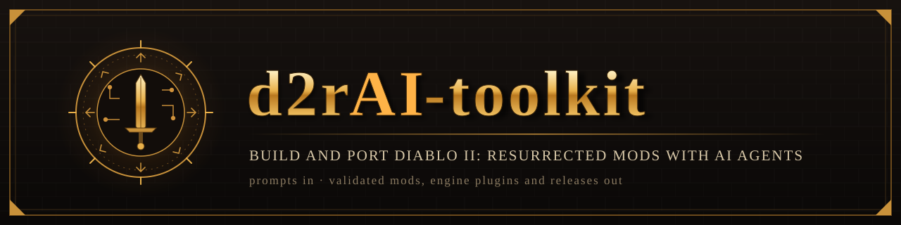
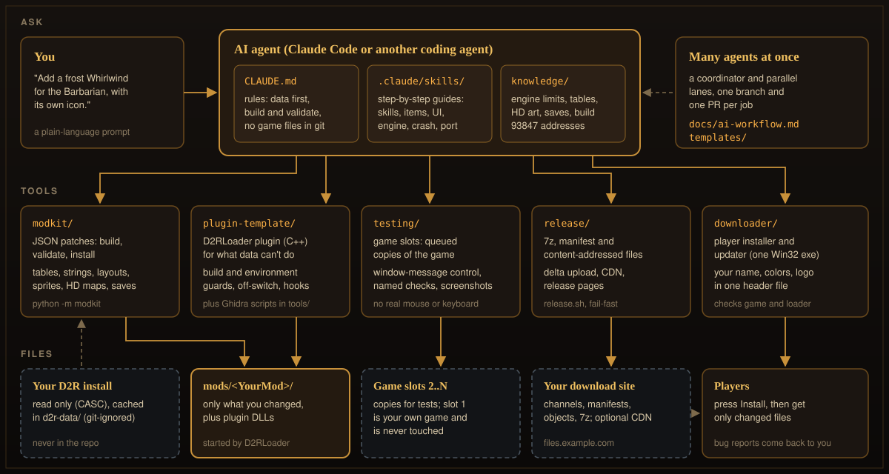
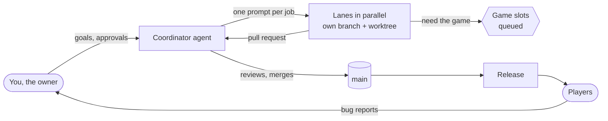

<p align="center"><i>made by a clanker</i></p>

<p align="center">
  
</p>

<p align="center">
  <b>Change how Diablo II: Resurrected works, not just its tables.</b><br>
  Describe the system you want. An AI agent splits it into data and engine work, builds it from D2R's own files and
  engine, tests it in real game copies, and helps you ship it.
</p>

<p align="center">
  <a href="https://github.com/Nugwa628/d2rAI-toolkit/actions/workflows/ci.yml"></a>
  <a href="LICENSE"></a>
  
  
  
</p>

<p align="center">
  <a href="#quick-start-5-minutes">Quick start</a> ·
  <a href="#your-first-prompt">First prompt</a> ·
  <a href="#skills">Skills</a> ·
  <a href="knowledge/README.md">Knowledge</a> ·
  <a href="docs/ai-workflow.md">AI workflow</a> ·
  <a href="docs/README.md">All docs</a> ·
  <a href="#faq">FAQ</a>
</p>

---

## What is this?

**d2rAI-toolkit** lets you change **Diablo II: Resurrected** at the engine level by talking to an AI coding agent
such as [Claude Code](https://docs.anthropic.com/en/docs/claude-code). New game systems, new skill functions, raised
hard limits and new UI panels: the agent plans the work, writes the data and the engine plugin, finds the game code
with Ghidra, and tests the result in copies of the game. A new skill or a bigger stash works the same way, just
smaller.

It gives the agent everything it needs to work safely on D2R:

- an **engine plugin template** for [D2RLoader](https://github.com/D2RLoader), an address registry for D2R build
  93847, and Ghidra scripts to find what isn't in it yet;
- a Python toolkit (`modkit`) that turns small JSON patches into a complete mod folder, built fresh from the game's
  own files every time and validated;
- a **knowledge base** of what the engine hard-codes, how every table and HD file works, how to plan a new game
  system, and how to debug crashes;
- **skills**: step-by-step guides the agent follows for each kind of job;
- the tools around a real project: testing in copies of the game, releases, distribution (your own host, GitHub or
  Nexus Mods) and a player downloader.

Everything here was learned the hard way, by porting a large classic overhaul mod to D2R with AI agents. The toolkit
works only with D2R's own files and engine. Blizzard's files are read from **your** install and never stored in the
repo.

<p align="center">
  
</p>

## What you can do

<table>
<tr>
<td width="50%" valign="top">

### ⚙️ Engine-level changes
Change what the game *does*. **New systems** (a mapping system, a new crafting bench), **new skill functions**,
**raised hard limits**, **new cube rules** and **UI panels**. The agent splits a system into data and a
[D2RLoader](https://github.com/D2RLoader) plugin, finds the hooks with Ghidra, and builds from a template with build
guards, an off-switch per part and a status command.
→ [new game systems](knowledge/new-game-systems.md) · [plugin-template](plugin-template/README.md) ·
[engine RE](knowledge/engine-re.md)

</td>
<td width="50%" valign="top">

### 🗡️ Data mods from prompts
"A frost Whirlwind for the Barbarian." "A 12 × 12 stash." "A new unique bow that drops from Andariel." The agent
clones the closest vanilla row, writes the patch, builds and validates it.
→ [modkit ops](knowledge/modkit-ops.md)

</td>
</tr>
<tr>
<td valign="top">

### 📜 Port a classic mod
With its creators' permission, bring a 1.10 / 1.13c-era mod to D2R: take stock, convert each table, keep the
ids D2R hard-codes, redo the old engine DLL's rules in a plugin.
→ [porting guide](knowledge/porting-classic-mods.md)

</td>
<td valign="top">

### 🧪 Test in real game copies
Game slots are frozen copies of your install, queued with locks. The agent controls them without your mouse or
keyboard, and runs named checks with screenshots. Your own game is never touched.
→ [testing](docs/testing.md)

</td>
</tr>
<tr>
<td valign="top">

### 📦 Ship releases, anywhere
Package a 7z plus a manifest of content-addressed files, upload only what changed, and create release pages from
your changelog. Players get a one-exe installer and updater with your name and colors. Or serve the files from
GitHub or Nexus Mods (`--nexus` writes a ready archive).
→ [release](docs/release.md) · [distribution](docs/distribution.md) · [downloader](docs/downloader.md)

</td>
<td valign="top">

### 🤖 Run many agents in parallel, safely
A coordinator plus short "lanes": one job each, with its own branch, worktree and PR. The coordinator reviews and
merges. You get templates for every prompt and list.
→ [AI workflow](docs/ai-workflow.md)

</td>
</tr>
<tr>
<td valign="top">

### 🧹 Keep your repo clean
A pre-commit scan for e-mails, IPs, user paths, keys, PNG metadata and **your own** private-words list. The same
scan runs in CI.
→ [keeping your repo clean](#keeping-your-repo-clean)

</td>
<td valign="top">

### 🩹 Triage crashes from players
Turn a player's crash report into a D2R function and a fix: RVA from RIP, stack return addresses, Ghidra, and which
logs to ask for.
→ [crash triage](knowledge/crash-triage.md)

</td>
</tr>
</table>

## Quick start (5 minutes)

You need Windows, an installed D2R 3.3, Python 3.12+, git, and Visual Studio with the C++ workload
([full list](#requirements)). **CMake must be on `PATH`.** Visual Studio's bundled CMake works: add
`<Visual Studio>\Common7\IDE\CommonExtensions\Microsoft\CMake\CMake\bin` to `PATH`. Commands use `py -3`, because
`python` on Windows may be the Microsoft Store stub. If D2R is not in the default folder
(`C:\Program Files (x86)\Diablo II Resurrected`), set `MODKIT_GAME` to its folder first:
`$env:MODKIT_GAME = "D:\Games\Diablo II Resurrected"`.

```powershell
# 1. Get the toolkit (with its CascLib and PluginSDK submodules)
git clone --recursive https://github.com/Nugwa628/d2rAI-toolkit.git
cd d2rAI-toolkit

# 2. Build CascLib, which reads the game's storage (needs cmake on PATH)
powershell -ExecutionPolicy Bypass -File tools\build_casclib.ps1

# 3. Copy the tables, strings and layouts out of YOUR install (into d2r-data/, which is git-ignored)
py -3 -m modkit fetch

# 4. Make a mod project next to the toolkit, build it, install it (with the game closed)
py -3 -m modkit new ..\mymod --name MyMod
py -3 -m modkit build ..\mymod
py -3 -m modkit install ..\mymod

# 5. Turn on the privacy scan for your commits
py -3 tools\install_hooks.py
```

Then start the game with `D2RLoader.exe` and pick **MyMod**, or run `D2R.exe -mod MyMod -txt`. Want a bigger
example? Build [`examples/showcase`](examples/showcase/) with `py -3 -m modkit build examples\showcase`. It builds
with 0 errors. The warnings it shows are in D2R's own data (vanilla formulas and seqnum values), plus one rename note.

Now open the folder in your agent (`claude` in a terminal) and start asking.

## Your first prompt

Start big. This is the kind of change the toolkit is for: a new game system that D2R's tables alone can't express.

> Add a Path of Exile-style mapping system to `..\mymod`. Maps drop in Hell with a tier from 1 to 10 and rolled
> modifiers (monsters deal extra fire damage, more monster life, extra packs). Transmuting a map in the cube in the
> Rogue Encampment opens a portal to a map area. The area level comes from the tier, the modifiers apply to every
> monster there, and the map is used up. Better tiers give better drops.

This is a multi-lane project, not one prompt and done. A good agent says so, and plans it like this.

**1. Reads the rules and the limits.** [CLAUDE.md](CLAUDE.md) says data before code. The request matches the
[`d2r-engine`](.claude/skills/d2r-engine/SKILL.md) skill and [new-game-systems.md](knowledge/new-game-systems.md).
[engine-limits.md](knowledge/engine-limits.md) shapes the design before a line is written:

| Limit | What it means for maps |
|---|---|
| The cube's "portal" output opens only the Cow Level | The portal needs a plugin hook on that output |
| Portals link levels within one act only | Map areas are Act 1 levels; the device is the cube in the Rogue Encampment |
| Portal links store the level as a byte in many places | Map areas need level ids of 255 or below: a pool of a few areas, reused, not one per map |
| levels.txt `Layer` below 100; clear `Position` on new maze levels | Set both on every cloned level, or entering it crashes |
| Levels come from levels.txt, loaded at startup | A map area is a pre-made level from the pool. Its layout is generated once per game, so a reused area keeps its layout until the next game |

**2. Splits the work into lanes** ([AI workflow](docs/ai-workflow.md)):

| Lane | Work | Tools |
|---|---|---|
| RE spike | Confirm each hook: the cube's portal output (and the checks it makes for the Cow Level), the portal maker, the monster spawn path the level populator uses, room to level. Record the signatures and entry bytes | `tools/ghidra_query.ps1` with `Decompile.java`, `Disasm.java`, `Refs.java`; [engine-re.md](knowledge/engine-re.md); the [93847 address registry](knowledge/d2r-93847-addresses.md) |
| Data | Item type `map`, 10 map bases, map affixes and the stats they roll, a pool of map levels cloned from a vanilla cave (with their lvlmaze rows), area levels per tier, treasure classes, the cube recipe, strings, stand-in HD art | `modkit` patches ([modkit-ops.md](knowledge/modkit-ops.md)), skills `d2r-items`, `d2r-monsters`, `d2r-cube` |
| Plugin | Three parts, each with its own off-switch word. `mapportal`: the cube output opens a portal to a free pool level and remembers the map's tier and modifiers. `mapmods`: monsters spawned in that level get the modifiers. `maplevel`: picks the area level for the tier and frees the level when the run ends | [plugin-template](plugin-template/README.md) |
| Tests | Named checks in a game slot: a map drops, the recipe consumes it, the portal leads to a map level, the area level matches the tier, a monster has the modifier's stats, the portal closes | [testing](docs/testing.md) |
| Release | Version bump, player changelog, publish; a `--nexus` archive if it goes on Nexus Mods | [release](docs/release.md), [distribution](docs/distribution.md) |

**3. Writes the data** in `..\mymod\patches\`, for example `040-maps.json` (shortened):

```json
{"ops": [
  {"op": "add_row", "table": "itemtypes",
   "values": {"ItemType": "Map", "Code": "map", "Equiv1": "misc", "Magic": 1, "Rare": 1, "StorePage": "misc"}},
  {"op": "clone_row", "table": "misc", "from": "Jewel", "key": "Map Tier 1",
   "set": {"code": "mp1", "namestr": "MapTier1", "type": "map", "level": 68}},
  {"op": "clone_row", "table": "levels", "from": "Act 1 - Cave 5", "key": "Act 1 - Map Area 1",
   "set": {"LevelName": "MapArea1", "MonLvl(H)": 70, "MonLvlEx(H)": 70, "Waypoint": 255, "Position": 0}},
  {"op": "clone_row", "table": "lvlmaze", "from": "Act 1 - Cave 5", "key": "Act 1 - Map Area 1"},
  {"op": "add_row", "table": "cubemain",
   "values": {"description": "map -> map portal", "enabled": 1, "version": 100, "numinputs": 1,
              "input 1": "map", "output": "Cow Portal"}},
  {"op": "string", "key": "MapTier1", "text": "Map (Tier 1)", "file": "item-names.json"}
]}
```

The real patch also sets `Layer` and the monster lists, the lvlmaze row's `Level` id, the other tiers and the
affixes. `py -3 -m modkit build ..\mymod` must end with 0 errors. The validator catches a maze level without a lvlmaze
row, broken references and bad ids.

**4. Writes the plugin parts.** Example: `mapmods`, a hook on the spawn-monster function from the registry. It is a
sketch in the template's style. The RE spike confirms the signature and the entry bytes first, as `hook_example.cpp`
shows.

```cpp
// map_mods.cpp: monsters spawned in a map area get that map's modifiers.
// 0x492cf0 (game, room, x, y, monster, mode, search, flags) -> unit: spawn monster (d2r-93847-addresses.md)
using SpawnFn = d2r::Unit* (*)(d2r::Game*, void* room, int32_t x, int32_t y, int32_t monster, int32_t mode,
                               int32_t search, int32_t flags) noexcept;
SpawnFn g_spawn = nullptr;  // trampoline, set by InstallInlineHook
std::atomic<uint32_t> g_count{0};

auto Spawn(d2r::Game* game, void* room, int32_t x, int32_t y, int32_t monster, int32_t mode, int32_t search,
           int32_t flags) noexcept -> d2r::Unit* {
	d2r::Unit* unit = g_spawn(game, room, x, y, monster, mode, search, flags);
	if (!unit || !room) return unit;
	const maps::Run* run = maps::RunFor(game, d2r::api.roomLevel(room));  // 0x2efc10 room -> level; mapportal set the run
	if (!run) return unit;                                                // not a map area: unchanged
	for (const maps::Mod& mod : run->mods)                                // read from the map item's stats
		maps::Apply(game, unit, mod);                                     // stats and states on the monster
	if (plog::Sample(g_count)) plog::Info("mapmods: %d mods on monster %d", run->count, monster);
	return unit;
}
```

**5. Tests and ships.** Each lane runs its named checks in a game slot and opens a PR. The coordinator merges, runs
the full suite, and releases. Expect several rounds: the first map run always finds something.

### A simple data change

Smaller jobs follow the same rules in one step:

> Add a frost version of Whirlwind for the Barbarian in `..\mymod`. It should replace Double Throw, do cold damage
> and have its own icon.

The agent uses the [`d2r-skill`](.claude/skills/d2r-skill/SKILL.md) skill. A class has exactly 30 skills, so it
*replaces* Double Throw (same row id, tree slot and save byte), clones Whirlwind and writes one op:

```json
{"ops": [{"op": "skill", "name": "Frost Cyclone", "replace": "Double Throw", "clone": "Whirlwind",
          "skills": {"EType": "cold", "EMin": 4, "EMax": 8, "ELen": 75},
          "text": {"name": "Frost Cyclone"}, "icon": "assets/frost_cyclone.png",
          "hdSequenceLike": "Whirlwind"}]}
```

That one op also creates the tooltip strings, the HD and classic icons, and the HD animation entry. Then it builds
with 0 errors, installs with the game closed, and adds a row to the project's `TESTING.md`.

## Repo map

| Path | What's inside |
|---|---|
| [`modkit/`](modkit/) | The Python toolkit (`py -3 -m modkit -h`): CASC reading, tables, strings, UI layouts, sprites/PNG/DC6, HD maps, patch ops, the `skill` op, validator, installer, save editor |
| [`knowledge/`](knowledge/README.md) | How D2R works for modders: limits, new game systems, tables, HD art, layouts, strings, saves, reverse engineering, addresses, debugging, porting |
| [`.claude/skills/`](.claude/skills/) | Step-by-step guides the agent follows ([list below](#skills)) |
| [`CLAUDE.md`](CLAUDE.md) | The agent's standing instructions and rules |
| [`docs/`](docs/README.md) | Guides for running a project: AI workflow, testing, releases, [distribution](docs/distribution.md) (own host, GitHub, Nexus Mods), downloader |
| [`templates/`](templates/) | Fill-in files: coordinator prompt, lane rules, lane prompt, bug list, plan, changelog, owner update |
| [`plugin-template/`](plugin-template/README.md) | D2RLoader plugin skeleton (C++): guards, off-switch, status command, a new skill function, an inline hook |
| [`testing/`](testing/) | Game slots, game control without real input, a checks framework, release-like installs |
| [`release/`](release/) | Packaging (7z + manifest, `--nexus` archive), delta publish over SFTP, server ingest, CDN mirror, release pages, `release.sh` |
| [`downloader/`](downloader/) | The player-facing Win32 installer and updater, configured by one header file |
| [`tools/`](tools/) | CascLib build, game image dump, Ghidra scripts, `check_public.py` and the git hooks |
| [`examples/showcase/`](examples/showcase/) | A small mod that builds with 0 errors: a reworked class skill, an item skill with a new missile, a bigger stash |
| [`tests/`](tests/) | Unit tests (`py -3 -m unittest discover tests`) |

## Skills

Skills live in [`.claude/skills/`](.claude/skills/). The agent picks the right one from your request; you can also
name it ("use d2r-port").

| Skill | Use it for |
|---|---|
| [`d2r-mod-setup`](.claude/skills/d2r-mod-setup/SKILL.md) | Set up the toolkit; create, build, install and run a mod; test characters |
| [`d2r-skill`](.claude/skills/d2r-skill/SKILL.md) | New or reworked skills: functions, damage, tooltip, tree slot, icon, missiles, states, HD animation |
| [`d2r-items`](.claude/skills/d2r-items/SKILL.md) | Base items, uniques, sets, runewords, affixes, drops, vendors, item art |
| [`d2r-monsters`](.claude/skills/d2r-monsters/SKILL.md) | Monsters, bosses, monster skills, spawns, area levels, difficulty |
| [`d2r-ui`](.claude/skills/d2r-ui/SKILL.md) | Inventory, stash and cube grids, panels, widget layouts, skill tree |
| [`d2r-cube`](.claude/skills/d2r-cube/SKILL.md) | Horadric Cube recipes and their condition limits |
| [`d2r-engine`](.claude/skills/d2r-engine/SKILL.md) | D2RLoader plugins, new engine functions, Ghidra reverse engineering |
| [`d2r-debug`](.claude/skills/d2r-debug/SKILL.md) | Crashes, asserts, lost characters, wrong behaviour: logs, symptom to cause, bisecting |
| [`d2r-crash`](.claude/skills/d2r-crash/SKILL.md) | A player's crash report: addresses to functions, who caused it, a fix with evidence |
| [`d2r-port`](.claude/skills/d2r-port/SKILL.md) | Port a classic 1.10 / 1.13c-era mod to D2R (with its creators' permission), table by table, with its DLL rules in a plugin |
| [`d2r-coordinator`](.claude/skills/d2r-coordinator/SKILL.md) | Plan and run a project with several agents: lanes, models, game slots, bug list, review |
| [`d2r-release`](.claude/skills/d2r-release/SKILL.md) | Ship a version: bump, player changelog, fail-fast publish, verify, release pages |

## Knowledge index

The [knowledge base](knowledge/README.md) is the toolkit's memory. The agent reads the topic file before it works
in an area. It's also good reading for human modders.

| Page | What it covers |
|---|---|
| [engine-limits.md](knowledge/engine-limits.md) | Every hard-coded limit a mod hits: the rule, the symptom when you break it, the fix |
| [new-game-systems.md](knowledge/new-game-systems.md) | Planning a new game system: data vs plugin, finding the hooks, where state lives, UI, lanes |
| [tables.md](knowledge/tables.md) | How D2R reads its `.txt` tables: indexed vs keyed, ids, adding rows safely, per-table notes |
| [hd-graphics.md](knowledge/hd-graphics.md) | `.sprite` files, item/skill/panel art, HD json maps, overlays, player and monster animation |
| [ui-layouts.md](knowledge/ui-layouts.md) | The HD layout json: widget tree, grids, panels, tabs, stash, inventory, cube, skill tree |
| [strings.md](knowledge/strings.md) | String files, whole-file replacement, safe new ids, the printf placeholder trap |
| [saves.md](knowledge/saves.md) | `.d2s` essentials, checksum, D2RLoader's extended saves, safe and unsafe edits |
| [engine-re.md](knowledge/engine-re.md) | Finding and hooking D2R code: memory dump, headless Ghidra, query scripts, hook rules |
| [d2r-93847-addresses.md](knowledge/d2r-93847-addresses.md) | Address registry for build 93847: functions, tables, record and unit offsets |
| [debugging.md](knowledge/debugging.md) | Symptom → cause → fix, from real bugs, and where every log lives |
| [crash-triage.md](knowledge/crash-triage.md) | From a player's crash report to a function and a fix, with a worked example |
| [d2rloader.md](knowledge/d2rloader.md) | D2RLoader facts and traps: default mod, the first start, other plugins, version checks |
| [porting-classic-mods.md](knowledge/porting-classic-mods.md) | Porting a classic mod: inventory, table conversion, fixed ids, function numbers, art order |
| [modkit-ops.md](knowledge/modkit-ops.md) | Every patch operation `modkit build` understands |

## How the AI workflow works

A small mod is one person and one agent. A big one runs like a small studio:



- **You decide**, the **coordinator** plans, writes lane prompts, reviews and merges, and **lanes** each do one bug
  or feature and open a PR. Lanes never merge.
- Strong models where judgement matters (coordinator, engine work), cheaper ones for routine lanes.
- One numbered bug list, targeted tests per lane, and the full test suite at milestones.
- Every merged fix gets released. The agent asks you before anything public, paid or destructive.

The full method, with failure modes and a starter checklist, is in **[docs/ai-workflow.md](docs/ai-workflow.md)**.
Ready-made prompts and lists are in [`templates/`](templates/).

## Keeping your repo clean

Mods are often built in private and published later. The toolkit helps keep private things out of public git:

```powershell
py -3 tools\install_hooks.py            # pre-commit + commit-msg hooks run the scan for you
py -3 tools\check_public.py             # scan files, PNG metadata, commit messages and authors
py -3 tools\check_public.py --no-history  # files only
```

- It finds **e-mails, IPv4 addresses, `C:\Users\<name>` paths, keys and tokens, and PNG text chunks**.
- It also checks **your own private-words list** (other projects' names, your real name, server names). Keep that
  list **outside** the repo, in `~/.d2r-modkit/private_terms.txt` (one word per line), or point
  `D2RAI_PRIVATE_TERMS` at it. Hits are printed masked, so logs don't leak the words.
- Generic false positives go in [`check_public.allow`](check_public.allow). Private-word hits can't be allow-listed.
- CI runs the tests and the generic scan on every push ([`.github/workflows/ci.yml`](.github/workflows/ci.yml)).
- Commit with a no-reply identity. To publish a squashed public copy of a private repo, see
  [tools/publish_mirror.md](tools/publish_mirror.md).

## Requirements

| What | Why |
|---|---|
| Windows 10 or 11 | D2R, D2RLoader and the native tools are Windows-only |
| Diablo II: Resurrected **3.3** (Battle.net or Steam) | The game files the mod is built from |
| Python **3.12+** (`py -3`) | `modkit` and every script (standard library only) |
| git, Visual Studio with the C++ workload, CMake **on `PATH`** (3.20+, 3.29+ for plugins; VS's bundled CMake in `Common7\IDE\CommonExtensions\Microsoft\CMake\CMake\bin` works) | CascLib (`tools\build_casclib.ps1`), plugins (`plugin-template\build.ps1`) and the downloader |
| [D2RLoader](https://github.com/D2RLoader) 1.3.1 *(optional)* | Plugins and extended saves |
| [Ghidra](https://github.com/NationalSecurityAgency/ghidra) *(optional)* | Reverse engineering for engine work |
| 7-Zip *(optional)* | Building release packages |
| An AI coding agent | Claude Code is the reference; see the [FAQ](#faq) for others |

## Status and limitations

We'd rather tell you now than have you find out later:

- **Target: D2R 3.3.** Data-only mods follow the 3.3 file layout and aren't tied to a build number.
- **Engine addresses are for build 93847 only** (D2R image under D2RLoader 1.3.1, PE timestamp `0x6ab3782c`). The
  plugin template checks the image at load and turns its engine parts off on any other image. After a game update,
  addresses must be found again ([engine-re.md](knowledge/engine-re.md)).
- The plugin template is a starting point, not a framework. Engine work still needs care and Ghidra.
- No classic MPQ/DC6/DCC conversion pipeline: art goes in as PNGs and becomes D2R sprites.
- Windows only. Parts of `modkit` run elsewhere, but the game and the native tools don't.

## FAQ

<details>
<summary><b>Does the repo contain any Blizzard files?</b></summary>

No, and it never should. `modkit fetch` reads the game files from your own install into `d2r-data/`, which is
git-ignored, as are build outputs, dumps and saves. A built mod contains only what you changed. Rule 1 in
[CLAUDE.md](CLAUDE.md) tells the agent the same.
</details>

<details>
<summary><b>Do I need D2RLoader?</b></summary>

Only for engine plugins or the extended save format (more than 30 skills per class, wide stat ids). A data-only mod
runs with `D2R.exe -mod <Name> -txt`. With D2RLoader, the first start after installing or updating it builds a cache:
start the game twice. See [d2rloader.md](knowledge/d2rloader.md).
</details>

<details>
<summary><b>Steam or Battle.net?</b></summary>

Both. They ship the same program under different build numbers. The Steam 3.3 build seen so far runs the same
image as Battle.net's 93847. That's why requirement checks use the game version (`3.3`), never a build number, and
plugins check the image itself.
</details>

<details>
<summary><b>Can I use another AI tool instead of Claude Code?</b></summary>

Yes. [CLAUDE.md](CLAUDE.md), the skills and the knowledge base are plain Markdown, and `modkit` is a normal CLI.
Point your agent's instruction file (for example `AGENTS.md`) at `CLAUDE.md` and tell it to read the matching
`SKILL.md` for each job. The workflow guide also covers mixing providers.
</details>

<details>
<summary><b>Can I use this to port an existing classic mod?</b></summary>

Yes, with permission from the mod creators. A mod is its creators' work: ask them before you start, and follow
their terms on credit and on whether and where the port may be published. If they say no, or you can't reach
them, don't port it. With permission, start with the `d2r-port` skill and
[porting-classic-mods.md](knowledge/porting-classic-mods.md). That's where most of the knowledge comes from.
</details>

<details>
<summary><b>Where do I host the mod: my own server, GitHub or Nexus Mods?</b></summary>

Any of them, or a mix. Your own host with the downloader gives one-click delta updates. GitHub Releases and Nexus Mods
host the files for free, and Nexus brings players. `package_release.py --nexus` writes an archive that is ready for
Nexus. See [distribution.md](docs/distribution.md) for the comparison and the Nexus API's limits.
</details>

<details>
<summary><b>Will it get me banned?</b></summary>

Modded games run offline. Keep mods and plugins away from Battle.net online play.
</details>

## Contributing

Bug reports, knowledge fixes and new skills are welcome. Please read [CONTRIBUTING.md](CONTRIBUTING.md) first.
Facts about the engine are the most valuable thing you can add: say which build, and how you know. Security issues:
[SECURITY.md](SECURITY.md). Everyone here follows the [Code of Conduct](CODE_OF_CONDUCT.md).

## Credits

- [D2RLoader](https://github.com/D2RLoader) and its PluginSDK, which make D2R plugins and extended saves possible.
- [CascLib](https://github.com/ladislav-zezula/CascLib), for reading the game's storage.
- The [LZMA SDK](https://www.7-zip.org/sdk.html) (public domain), used by the downloader.
- [Ghidra](https://github.com/NationalSecurityAgency/ghidra), the reverse engineering suite behind the engine work.
- Built from lessons learned porting a large overhaul mod to D2R, and from the modding community's decades of
  table documentation.

## License

[MIT](LICENSE) © Nugwa628 and contributors. Third-party code in submodules and `downloader/third_party/` keeps its
own license.

---

<sub>d2rAI-toolkit is an unofficial fan project. It is not affiliated with, endorsed by or sponsored by Blizzard
Entertainment. Diablo and Diablo II: Resurrected are trademarks of Blizzard Entertainment, Inc. You need your own
legal copy of the game.</sub>
