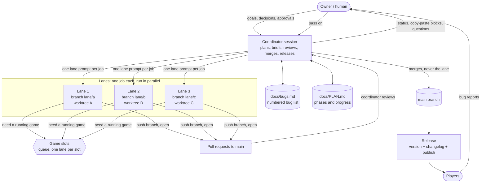

# Running a D2R mod project with AI agents

This guide explains a working method for building or porting a Diablo II: Resurrected mod with AI agents. It comes
from a large classic-to-D2R overhaul port that was run this way: one human owner, one coordinator agent, and
dozens of short-lived worker agents ("lanes").

You do not need all of it. A small mod can be one person and one agent. But once a project has more than a handful of
open problems, the pieces below keep it from falling apart.

Ready-made files for everything in this guide are in [`templates/`](../templates/). Two skills wrap the two main
jobs: `d2r-coordinator` (plan and run lanes) and `d2r-release` (ship a version).

## Contents
1. [The big picture](#1-the-big-picture)
2. [The roles](#2-the-roles)
3. [Lanes: one job, one branch, one PR](#3-lanes-one-job-one-branch-one-pr)
4. [Choosing models and providers](#4-choosing-models-and-providers)
5. [Game slots and testing](#5-game-slots-and-testing)
6. [The bug list](#6-the-bug-list)
7. [Releasing](#7-releasing)
8. [Safety: secrets, identity, public things](#8-safety-secrets-identity-public-things)
9. [Talking to the human owner](#9-talking-to-the-human-owner)
10. [Writing a good lane prompt](#10-writing-a-good-lane-prompt)
11. [Common failure modes and fixes](#11-common-failure-modes-and-their-fixes)
12. [Starter checklist](#12-starter-checklist)

---

## 1. The big picture



The loop in one sentence: **the owner decides, the coordinator plans and merges, lanes do one job each and open a pull
request, and every merged fix is released.**

## 2. The roles

| Role | Does | Never does |
|---|---|---|
| **Owner** (human) | Sets goals, answers questions, approves anything public, paid or destructive, plays the game, reports bugs. | Has to read code or run lane commands (the coordinator gives copy-paste blocks). |
| **Coordinator** (one long agent session) | Plans phases, splits work into lanes, writes lane prompts, reviews and merges PRs, builds and tests merged results, bumps versions, releases, keeps the docs current. | Does the big implementation work itself. A coordinator that codes gets slow and loses the overview. |
| **Lane** (short agent session) | Does exactly one bug or feature on its own branch, runs the tests for what it touched, opens a PR, reports. | Merges, touches files outside its job, releases, or messages other agents. |

Keep the coordinator on your strongest model. It reviews other agents' work and makes judgement calls, so it is the
worst place to save money.

## 3. Lanes: one job, one branch, one PR

**One bug or feature per lane.** Two bugs in one lane means one slow review, one big diff, and one fix you can't ship
without the other. If two reports look related, merge them into one bug first (see [section 6](#6-the-bug-list)),
then give that one bug to one lane.

**Each lane works in its own checkout.** Use a git worktree (or a separate clone) so lanes never share a working
directory:

```bash
git fetch origin
git worktree add ../lanes/fix-crash-andariel -b lane/fix-crash-andariel origin/main
```

Rules that keep this safe:

- A lane branch is named `lane/<short-name>` and starts from the current `origin/main`. Say so in the prompt. A lane
  that starts from some other branch drags that branch's changes into its PR.
- **Lanes open PRs and never merge.** The coordinator reads the diff, checks the tests, merges, and resolves
  conflicts. This is the main quality gate.
- A lane only edits the files its job needs. If it finds a second problem, it writes it down in its report instead
  of fixing it. The coordinator turns that into a new bug and a new lane.
- Merge in a separate worktree (`git worktree add --detach ../merge-wt origin/main`), not in the checkout a release
  job is using.
- The lane's final report always has the same shape: PR link, head commit, what changed, what was tested and how,
  what is left. See [`templates/lane-prompt.md`](../templates/lane-prompt.md).
- **A lane that "finishes" while waiting on something has actually stopped.** Ending a turn ends the lane. Tell every
  lane: never end your turn while a build, install or game run you started is still going; wait for it in the same
  turn. If a lane reports "waiting for the run", check its branch and PR before you trust the report, then send it a
  follow-up telling it to continue.

### How the coordinator runs a round

1. Read the bug list and plan. Pick the next jobs.
2. Write one prompt per job (from the template). Start the lanes, each on a fresh branch from `main`.
3. While they run, review earlier PRs, update docs, answer the owner.
4. When a PR arrives: read the diff, check the tests it claims, merge it in a separate worktree, run the targeted
   checks for the merged code.
5. When a batch of fixes is merged: release ([section 7](#7-releasing)).

## 4. Choosing models and providers

Match the model to the risk of the job. Cheap models are fine for work where a mistake is obvious and easy to fix.
Expensive models pay for themselves on work where a mistake is subtle and costs a day.

| Job | Model tier | Why |
|---|---|---|
| Coordinator session | Strongest | Reviews everything, makes the calls. |
| Reverse engineering the game binary, writing plugin/engine hooks, crash analysis, anything that touches code addresses, release-critical fixes, reconciling two lanes that fixed the same thing | **Strongest** (e.g. Claude Opus class) | Wrong guesses crash the game or corrupt saves, and the reasoning is long. |
| Data-table work, tools, scripts, tests, most bug lanes once you know roughly where the cause is, docs that need judgement, icon and image pipelines | **Mid** (e.g. Claude Sonnet class) | Good enough, much cheaper and faster. |
| Inventories, counting rows, grepping, renaming, converting a list, summarising logs, mechanical edits with a clear spec, test scaffolding, proofreading a diff for slips | **Small / cheap** (e.g. Claude Haiku class, or another provider's small model) | No design decisions are needed. |

### Multiple providers

Spread lanes over several accounts or providers when you can:

- It avoids rate limits and usage caps hitting all your lanes at once. Alternate heavy lanes between two accounts
  of the same provider.
- A different provider is a useful second pair of eyes. Use it for mechanical work and for a "does this diff have
  obvious slips" review. Treat its review as a hint, not a verdict.
- Look up the live provider and model names from your orchestration tool each session. They change often. Don't
  hard-code them in long-lived docs.

Give each lane a model on purpose: the table above is a default, and the coordinator may promote a job to a stronger
model when a cheaper lane gets stuck twice.

## 5. Game slots and testing

Agents that run the real game need somewhere to run it. Sharing the player's own install is how saves get overwritten.

- Make a few **slots**: frozen copies of the game install in their own folders, each with its own save folder.
  Keep your own real game out of the pool and mark it "never touch".
- **Slots are queued, not added.** Do not make a new slot for every lane. A lane does all its offline work first,
  then takes a lock on a slot, runs, restores the slot, and releases the lock. If every slot is locked, it waits in
  a bounded polling loop (a few minutes at a time, up to about half an hour) and continues as soon as one is free. It
  does not end its turn.
- **A lane only installs into or stops a game on a slot it holds the lock for, checked at that moment.** Never kill
  processes by a broad filter; kill only the process ids the lane started.
- Put the slot number on *every* command that touches saves or a game folder (an environment variable or a flag).
  A shell does not keep `export`s between tool calls, and a tool that defaults to slot 1 will overwrite whoever
  holds slot 1.
- Tests run in the background. Nothing may send synthetic keyboard or mouse input or steal focus, because the human
  may be using the machine.
- Lanes use their own throwaway characters. They never move, rename or delete saves they did not create.

### Targeted tests, full suite at milestones

After a change, run only the checks for the code that changed: map each source file to the checks that exercise it,
and run those, plus the cheap always-on checks (the build validator, unit tests, a boot smoke test). The full suite is
slow and game-bound. Run it at milestones: end of a phase, before a big release, before the owner plays after many
changes. And then one game at a time.

### Test what players get

A developer install is not what players have. Developer installs often use debug switches, loose text tables and a
test harness that is compiled out of release builds. Bugs hide there and appear for players. So:

- For anything player-facing, install the **release package** onto a slot exactly as your installer would (a
  `release_install` style script), run the check, then restore the slot.
- Verify the game, loader and plugin versions in the player's report against yours before chasing a ghost. Many
  "bugs" are a stale plugin copy or the loader pointing at another mod.
- Crash reports from players need the loader log and the crash report file. A plugin's own log stops silently when
  the game dies.

## 6. The bug list

Keep **one numbered list** of every report: `docs/bugs.md` (template: [`templates/bugs.md`](../templates/bugs.md)).

- Every report gets the **next number immediately**, with the date, who reported it, and the symptom in the
  reporter's words. A number makes it possible to say "fixed bug 17" in a commit, a lane prompt and a changelog.
- **Merge related bugs before you fix them.** Two reports with the same crash address and registers are one bug even
  if the players describe two causes. A "missing icon" and a "wrong icon" from the same table are one bug. Write
  "same as #N" in the new row and fix once. This is the cheapest bug fix there is.
- Status words: `open`, `in progress (lane x)`, `fixed in <version>`, `won't fix (reason)`, `duplicate of #N`.
- Put the *cause* in the row once you know it. Future agents read this list to avoid repeating dead ends.
- One bug, one lane. Name the lane after the bug.

## 7. Releasing

**Release after every batch of fixes**, not once a quarter. Small releases make it obvious which change broke what, and
players see their report get answered.

The steps (the `d2r-release` skill walks through them):

1. All fixes for the version are merged and the targeted checks pass.
2. Bump the version (once, in one place).
3. Write the changelog section in the player's words ([`templates/CHANGELOG.md`](../templates/CHANGELOG.md)).
4. Run the **whole release as one script** with `set -euo pipefail`, which stops at the first failed step and refuses
   to run if the version, the changelog and the build disagree.
5. Create the public release pages only after the version is confirmed live.
6. Update the bug list: fixed rows get the version.

Hard-won rules:

- **Don't switch branches, rebase, or edit in the checkout a release is running from.** Tags and package contents
  are read from the working tree while the job runs. One release got its tag on the wrong commit this way. Capture
  the commit hash first and do other work in a separate worktree.
- **Never pipe publish output through `tail`, `head` or `grep`** in the release script. A pipe hides the exit code of
  the failing command, and a failed upload was reported as a success. If you want a shorter log, write it to a
  file and read the file.
- Generated files can change line endings after a build. A real content change in a generated file must be committed
  before the release; a pure line-ending change should not block it.
- Compare any server-side script that ingests uploads with the repo's copy before you publish.
- Publishing is outward-facing: the first time, and any time the target or channel changes, ask the owner.

## 8. Safety: secrets, identity, public things

- **Secrets stay out of chat and out of the repo.** Tokens, passwords and private keys live in files in the user's
  home folder (for example `~/.my-mod/api_token`) that the owner creates themselves. Scripts read them. Agents
  never print them, echo them, commit them or put them in a prompt, a PR body or a log. If an agent genuinely needs a
  new secret, the owner enters it through a private input channel, never in the conversation.
- **Commit identity is a noreply address.** Set `user.name` and `user.email` to the owner's public handle and the
  host's `...@users.noreply...` address, for every lane. Never use a real e-mail in a commit, a doc or a prompt. Give
  the exact `git -c user.name=... -c user.email=... commit` form in the lane rules, so a lane that forgot to configure
  git still commits correctly.
- Commit messages end with a `Co-Authored-By:` line naming the model, and PR bodies end with the tool's
  attribution line, if the owner wants them. Say which in the lane rules.
- **Private words list.** Keep a text file *outside* the repo with names that must never be published (other
  projects, real names, hosts, addresses). Run a scan against it before every commit and before every push to
  a public place. See `tools/check_public.py`. The list itself never goes in the repo.
- **Never commit game files.** Blizzard's files are read from the user's own install. Not dumps, not extracted
  tables, not saves, not screenshots of the game.
- **Ask before anything public, paid or destructive**: making a repo public, publishing a release, a force-push,
  deleting branches or saves, spending money, touching the owner's real game install.
- Downloaded archives and installers are untrusted. Unpack them into a new empty folder, don't run their executables,
  and run any Python that reads them with `-I`.

## 9. Talking to the human owner

The owner is busy and isn't reading code. A good coordinator message is short and has the same three parts every time:

- **Done**: what was merged or released (with the bug numbers).
- **Running**: which lanes are active and what each is waiting for.
- **Need from you**: the decision or action, if any, as a **copy-paste block** with the expected output.

Use tables for status. Don't ask a question the code, the docs or a sensible default can answer; pick the default,
say you did, and move on. When you do need an answer, ask one clear question and offer your recommendation.

[`templates/owner-update.md`](../templates/owner-update.md) has a ready-made shape.

## 10. Writing a good lane prompt

A lane starts with no memory. Your prompt is everything it knows. A good prompt is short and complete:

1. **The goal in one sentence**, and why it matters.
2. **Read first**: the rules file and the two or three docs that matter. Name them by path.
3. **Scope**: the files and areas the lane may change. Everything else is out of bounds.
4. **What is already known**: cause found, things already ruled out, the bug row. This stops it redoing your work
   and stops it confirming your guess too eagerly. If you suspect a cause, say it is a suspicion.
5. **Done means**: the tests that must pass and the evidence to include. "Fixed" is not evidence; a check result is.
6. **Git**: branch name, base, commit identity, open a PR to `main`, do not merge.
7. **Shared resources**: how to get a game slot and what to do while waiting.
8. **Report format**: PR link, head commit, files changed, tests run with results, what is left, any incidents.
9. **Never end your turn while something you started is still running.**

Rules that every lane needs live in one shared file ([`templates/lane-rules.txt`](../templates/lane-rules.txt)), so
the prompt itself starts with "read the rules and follow them" and only carries the job-specific parts. When you learn
a new rule the hard way, add it to the file with the date, so every future lane gets it.

Tips:

- One job per prompt. If the prompt needs "and also", write two prompts.
- Prefer concrete paths, commands and expected output over adjectives.
- Say what *not* to do when the obvious approach is wrong ("don't patch the table; the crash is in the loader").
- For reverse-engineering lanes, give the build number and the address list, and tell the lane to re-verify every
  address by checking the bytes.

## 11. Common failure modes and their fixes

| What goes wrong | Why | Fix |
|---|---|---|
| A lane "completes" but nothing was pushed. | It ended its turn while a build or run was still going, or it ran out of steam. | Check the branch and worktree. Send a follow-up that says to continue. Put "never end a turn while something you started is running" in the rules. |
| A lane's PR contains unrelated changes. | The lane started from a branch other than `main`, or the coordinator had another branch checked out. | Always branch from `origin/main`. Start lanes from `main`. Cherry-pick the real commits into a clean branch. |
| Two lanes fix the same root cause two ways. | The bugs were never merged. | Keep one approach. Turn the other into a self-check so nothing is corrected twice. Merge related bugs before assigning. |
| One lane overwrote another's installed build or save. | No lock, or the lane unlocked between install and test. | Lock a slot for the whole session, check the lock right before installing, put the slot on every command. |
| A lane killed someone else's game. | Broad process kill. | Kill only process ids the lane started. |
| Tests pass on your install, players still crash. | Developer install is not the release package. | Test with the release installer on a slot. Compare file hashes with the player's. |
| The release says "success" but the version is not online. | Output piped through `tail`, or no `set -e`. | Use a single script with `set -euo pipefail`, no pipes on the publish steps, and create public pages only after a live-version check. |
| Release tag points at the wrong commit. | The checkout was switched or rebased mid-release. | Capture the commit hash first, never touch the release checkout, merge elsewhere. |
| The same lane keeps failing the same way. | Wrong model or missing context. | Re-brief with what it tried, or promote the job to a stronger model. Two failures is the limit for the same prompt. |
| Agents invent column values or addresses. | Nothing to check against. | Make them clone the nearest vanilla row, and require byte checks for addresses. |
| A token or e-mail showed up in a PR. | Secrets in prompts or logs. | Rotate the token. Scan before every commit. Keep secrets in files outside the repo. |
| The coordinator is buried in detail. | It is doing lane work. | Delegate, keep only the plan, the bug list and the merges. |
| Players report a crash you can't reproduce. | Setup problem: wrong loader mod folder, stale plugin copy, different build. | Have the plugin log its own path, version and the other loaded plugins at startup. Ask for the loader log and the crash report. |
| A lane stalls waiting for a game slot forever. | All slots locked by lanes that ended without unlocking. | Check slot status. Stale locks from finished lanes are cleared by the coordinator. |
| Docs drift from reality. | Nobody owns them. | Docs updates are part of the lane's "done". The coordinator checks them at merge. |

## 12. Starter checklist

Setting up a project:

- [ ] Repo created, `main` protected in practice (only the coordinator merges).
- [ ] `docs/PLAN.md`, `docs/bugs.md`, `CHANGELOG.md` created from the templates.
- [ ] Lane rules file written; private-words list created outside the repo; `tools/check_public.py` wired in.
- [ ] Commit identity decided (noreply address) and written into the rules.
- [ ] Game slots set up and locked-down; the owner's real install marked untouchable.
- [ ] Tokens and keys placed by the owner in files in their home folder.
- [ ] Coordinator prompt filled in from [`templates/coordinator-prompt.md`](../templates/coordinator-prompt.md).
- [ ] First lanes chosen: setup and inventory first, then tools, then data.

Per bug:

- [ ] Added to the bug list with the next number. Related bugs merged.
- [ ] One lane, one branch, one PR.
- [ ] Targeted checks run; release-package test for player-facing fixes.
- [ ] Merged by the coordinator. Bug row updated with the version.
- [ ] Released with a changelog entry.
