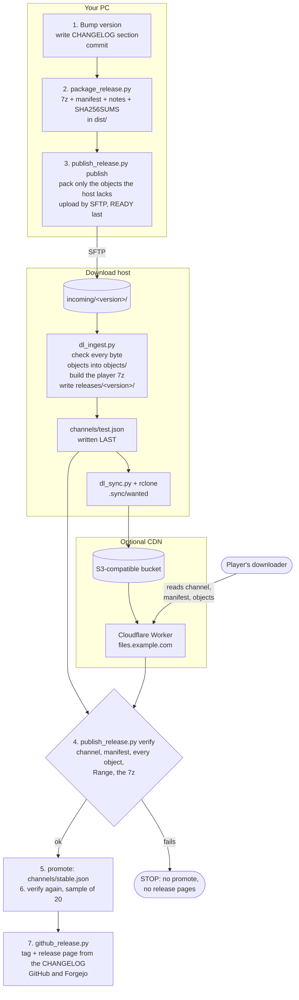
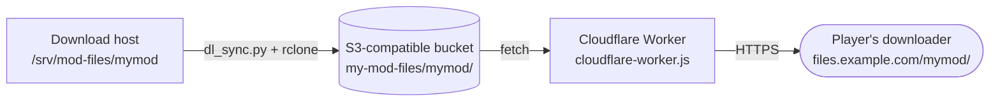

# Releasing a mod

How a finished mod gets to players: pack it, upload only what changed, let the server check it, and tell people. The
tools are in `release/`. They are Python 3.12+ (standard library only) plus 7-Zip, `sftp` and bash. The player's end is
the [downloader](./downloader.md). Testing what players get is in [testing.md](./testing.md). Serving the files from
GitHub Releases or Nexus Mods instead, or as well, is in [distribution.md](./distribution.md).

Contents: [Quick start](#quick-start) · [The flow](#the-flow) · [Before you release](#before-you-release) ·
[release.sh](#releasesh) · [The steps by hand](#the-steps-by-hand) · [Release notes](#release-notes) ·
[Release manifest](#release-manifest) · [Hosting layout](#hosting-layout) · [The download host](#the-download-host) ·
[CDN mirror](#cdn-mirror) · [The config file](#the-config-file) · [Lessons](#lessons) · [Troubleshooting](#troubleshooting)

## Quick start

Once per project:

```sh
cp release/release.example.toml release.toml       # then edit: mod.*, site.*, repos.*, downloader.*
python release/release_config.py check             # lists the settings that are still placeholders
```

Set up the download host once ([The download host](#the-download-host)). Then, for every release:

```sh
# 1. Bump the version where the project keeps it, and add a "### 1.0.1" section to CHANGELOG.md. Commit both.
# 2. One script does the rest. It stops at the first error.
bash release/release.sh 1.0.1 --mod-dir path/to/MyMod --plugin build/my-plugin.dll --plugin-version 1.0.1 \
    --downloader build/MyMod-Downloader.exe
```

It packs the mod, uploads it to the `test` channel, waits until the server has published it, checks it over HTTPS like a
player, moves the `stable` channel to it, checks again, and only then creates the release pages on GitHub and Forgejo.
Run it from a clean checkout and do not switch branches while it runs ([Lessons](#lessons)).

## The flow



Three ideas carry the whole design:

- **Files are stored by their hash.** Every file of a release is stored once as `objects/<aa>/<sha256>`, shared by all
  versions. An update uploads and downloads only the files that changed.
- **The channel file is written last.** A channel (`stable`, `test`) is a tiny JSON that names a version. Players read
  it first. Everything it points at is on the host *before* it changes, so a half-finished release is never visible.
- **The server checks, not the uploader.** The uploader only sends bytes. A separate program on the host verifies every
  size and hash, rebuilds the player's 7z from the verified objects, and publishes. A damaged or odd upload is refused
  and leaves the live site as it was.

## Before you release

| Need | Where |
|---|---|
| A finished mod folder | The folder that goes to `<D2R>/mods/<folder>`: `<folder>.mpq/data`, `modinfo.json`, `d2rloader/...`. `package_release.py` never changes it. |
| `release.toml` | Copy of `release/release.example.toml`. Pass `--config PATH` if it is not in the current folder. |
| 7-Zip on your PC | `7z.exe` under Program Files, or `7z`, `7zz`, `7za`, `7zr` on `PATH`. The run stops early without it. |
| `sftp` and a key | OpenSSH `sftp` on `PATH` (`MODKIT_SFTP` replaces the command, for example `sftp -F my_ssh_config`), and a private key for the upload user: `site.identity`. |
| The host | Set up once ([The download host](#the-download-host)). |
| A release plugin DLL (optional) | Built with the test harness compiled out. See [testing.md](./testing.md#the-harness-protocol). |
| A built downloader (optional but wanted) | `downloader/` builds it. Pass it to every release ([Lessons](#lessons)). |
| Tokens for the release pages | Environment variables `MODKIT_GITHUB_TOKEN` / `MODKIT_FORGEJO_TOKEN`, or the token files `~/.d2r-modkit/github_token` / `forgejo_token`. Never in the repo, never in chat. |
| Permission | Publishing is outward-facing. Ask the owner the first time, and whenever the target or channel changes. |

1. **Bump the version** in the one place your project keeps it (plugin version, mod metadata, and the downloader's
   `downloader/VERSION` if the downloader changed). A version is `1.2.3`, or `1.2.3-rc1` for a pre-release. A leading
   `v` is dropped.
2. **Write the changelog section** `### <version>` ([Release notes](#release-notes)).
3. **Commit.** `release.sh` refuses a checkout with uncommitted changes to tracked files (`--allow-dirty` skips this).
   A pure line-ending change in a generated file is not a reason to block, but a real content change must be committed.
4. **Check the config:** `python release/release_config.py check`. It lists settings that still hold placeholder text.
   `python release/release_config.py get site.url` prints one value.

## release.sh

```sh
bash release/release.sh <version> --mod-dir <finished mod folder> [options]
```

| Option | Meaning |
|---|---|
| `--config FILE` | The release config (default `./release.toml`). |
| `--mod-dir DIR` | **Required.** The finished mod folder. |
| `--plugin DLL` | A release plugin DLL, copied into the mod folder (`package.plugin_dir`). A DLL that contains a string from `package.plugin_forbidden_strings` is refused. |
| `--plugin-version V` | The version text that must be inside that DLL (the DLL has to carry `V` followed by a zero byte). Goes into the manifest as `pluginVersion`. |
| `--game-extract DIR` | The game's own extracted files. A mod file that is a byte copy of the same path there is left out: the game reads its own copy anyway. |
| `--downloader EXE` | The downloader to publish. Default: `downloader.exe` from the config, if that file exists. |
| `--commit-github SHA`, `--commit-forgejo SHA` | The commit to tag. Default: `HEAD`, read at the start. |
| `--no-github`, `--no-forgejo` | Skip that release page. A service whose repo setting still contains `your-name` is skipped too. |
| `--wait SECONDS` | How long to wait for the public site to show the new version (default 1200). |
| `--allow-dirty` | Do not insist on a clean checkout. |
| `-h`, `--help` | Show the header of the script. |

It sets `set -euo pipefail` and runs these steps in order. The first failure ends the script with a non-zero status.

| # | Step | Command | Stops when |
|---|---|---|---|
| 1 | Checks | `release_config.py check` and shell tests | The version is not `1.2.3` / `1.2.3-rc1`; `--mod-dir` is missing; the config does not load; `site.url` is not `https://...` ending in `/`, or still contains `example.com`; the changelog is missing or has no `### <version>` section; the downloader file does not exist; tracked files are modified. |
| 2 | Package | `package_release.py` | There is no 7-Zip; a forbidden file is in the mod folder; the plugin DLL is wrong. **Clears `package.dist` first.** |
| 3 | Publish | `publish_release.py publish --channel <site.publish_channel>` | Any upload error after the built-in retries. |
| 4 | Verify live | `publish_release.py verify --expect-version V --wait N` on the publish channel | The version does not show up on the public URL within the wait: **no promote, no release pages**. |
| 5 | Promote | `publish_release.py promote V --channel <site.promote_channel>`, then `verify --sample 20` | The version is not on the promote channel: no release pages. |
| 6 | Release pages | `github_release.py V --service github` (with `--latest`), then `--service forgejo` | An API error. |

Re-running after a failure is safe: `publish` resumes (it sends only what is missing), `promote` writes the same file
again, and `github_release.py` updates a release instead of creating a second one. It uses `$PYTHON`, else `python3`
(3.12+), else `py -3`, else `python`.

## The steps by hand

Each step is a script you can run alone. All take `--config FILE`; for `publish_release.py` it goes before the
subcommand (`publish_release.py --config FILE publish ...`).

### 1. Package: `package_release.py`

```sh
python release/package_release.py --mod-dir path/to/MyMod --version 1.0.1 [--plugin DLL [--plugin-version V]] \
    [--game-extract DIR] [--incomplete] [--nexus] [--out dist]
```

Writes into `dist/` (`package.dist`):

| File | Content |
|---|---|
| `<Folder>-<version>.7z` (for example `MyMod-1.0.1-rc1.7z` for a pre-release) | The manual download. Solid LZMA2 7z (`-mx7`) with the mod folder at the top. Time stamps are left out and file times are fixed, so one 7-Zip build always makes the same archive from the same folder. |
| `release-manifest.json` | The manifest ([schema below](#release-manifest)) with every file's size and sha256. |
| `RELEASE_NOTES-1.0.1.md` | A skeleton: requirements and install steps. Fill in the `TODO` parts if you ship it. |
| `SHA256SUMS` | sha256 of the three files above (`sha256sum -c` format). |

It copies the folder to `dist/stage/` first and works on the copy. It **refuses** to package files that match
`package.forbidden`: test-harness files, `imgui.ini`, `debugsettings.json`, `input-bindings.toml`, saves and their
sidecars (`.d2s .d2i .d2x ...`), logs and dumps. `--incomplete` makes a CI package without the game data: the manifest
says `complete: false`, the 7z gets `-incomplete` in its name, and publishing it to `stable` is refused.
`--nexus` also writes `<Folder>-<version>-nexus.7z`: the same folder plus an `INSTALL.txt` for players who extract it by
hand, ready to upload to Nexus Mods ([distribution.md](./distribution.md#a-nexus-ready-archive)).

### 2. Publish: `publish_release.py publish`

```sh
python release/publish_release.py publish --version 1.0.1 --channel test --downloader build/MyMod-Downloader.exe
```

| Option | Meaning |
|---|---|
| `--version V` | **Required.** Must match the manifest in `--dist`. |
| `--channel C` | The channel the server points at this version when it is done (default `site.publish_channel`). `--no-channel` uploads without touching a channel. |
| `--dist DIR` | The packager's output (default `package.dist`). |
| `--downloader EXE`, `--downloader-version V` | Publish this downloader with the release. The version is read from the exe's version resource; a different `--downloader-version` is refused. An exe with no version resource needs `--downloader-version`. |
| `--target T`, `--identity KEY` | Where to upload: `dir:<path>` (a local folder, for tests) or `sftp://user@host[:port]/path`. Default: `MODKIT_PUBLISH_TARGET`, then `site.target`. Give the path the way the server sees it, that is inside the chroot. `/~/x` means `x` under the login home. A target that still contains `<` (like `<your-server>`) is refused. |
| `--stage DIR` | Read file bytes from this mod folder instead of from the 7z. |
| `--work DIR` | Folder for the objects 7z, kept for a re-run (default `<dist>/upload/<version>`). |
| `--allow-incomplete` | Accept an `--incomplete` package (test channel or `--no-channel` only). |
| `--force` | Replace a waiting or refused upload, or a published version. |
| `--retries N` | Tries again after a dropped connection (default 5; waits 20 s times the attempt number). |

What it does:

1. A single SFTP login reads which objects are on the host and whether this version is already there.
2. Objects the host lacks are packed into **one** solid 7z, with each entry named by its sha256. The file stays in
   `dist/upload/`, so a second run sends exactly the same bytes.
3. That 7z, the manifest (plus `objectsBase` and, with `--downloader`, the `launcher` entry), the notes and the
   downloader go to `incoming/<version>.uploading/`. This folder is next to the site root, so it is never served. Each
   file goes up under a temporary name and is renamed. A dropped line resumes the big file (`reput`).
4. A `READY` file is written **last**, then the folder is renamed to `incoming/<version>/`. That rename is what the
   server reacts to.

The same command run again resumes. If the version is already published with the same contents it only rewrites the
channel file. If the contents differ it refuses: **a published version never changes**; build a new version, or use
`--force`.

### 3. Promote, list, collect, verify

```sh
python release/publish_release.py promote 1.0.1 --channel stable   # point a channel at a published version
python release/publish_release.py list                             # channels, releases, waiting uploads, last mirror sync
python release/publish_release.py gc --keep 3 --dry-run            # then without --dry-run
python release/publish_release.py verify --url https://files.example.com/mymod/ --channel stable \
    [--sample 200] [--expect-version 1.0.1 [--wait 1200]]
```

- **promote** checks that the release is on the host, that none of its objects is missing, and that it is not
  `complete: false` for `stable`. Then it writes the channel file and asks for a mirror sync.
- **gc** keeps the newest N releases and every release a channel points at. It removes the other releases, the
  downloaders only they used, and the objects no kept release uses. It deletes the manifests first, so a stopped run
  leaves unused objects, never a release with holes. It refuses to run if it cannot read a manifest it needs.
- **verify** does what a downloader does, over the public URL: channel, manifest (its sha256 must equal the channel's),
  every object (size and sha256), a `Range` request on the largest object (the answer must be 206), and the 7z (full
  sha256, or only the length when `--sample` is given). `--expect-version V --wait N` polls the channel until it names `V`,
  because a mirror or CDN can take a while.

Exit status of every script is 0 on success and 1 on failure, with the reason on stderr.

### 4. Release pages: `github_release.py`

```sh
python release/github_release.py 1.0.1 --service github --commit <sha> --downloader build/MyMod-Downloader.exe --latest
python release/github_release.py 1.0.1 --service forgejo --commit <sha> --dry-run
```

Creates or updates the release `v<version>` from the changelog section ([next section](#release-notes)), with
install links to the downloader and the 7z on your site. The 7z is **not** attached; players get it from the download host.
`--downloader` attaches the small exe. A version with `-` in it (`1.0.1-rc1`) becomes a pre-release. `--dry-run` prints
the tag and body and needs no token. Repositories and tokens come from `[repos]`; the token is never printed.

## Release notes

`release.sh` and `github_release.py` read the **`### <version>` section** of `CHANGELOG.md` (`repos.changelog`). The
heading may carry a date after the version (`### 1.0.1 (2026-01-12)`). `### 1.0.1-rc1` is not the section of `1.0.1`.
The section ends at the next `###` or `##` heading, so use bold labels or `####` inside it:

```markdown
## Releases

### 1.0.1 (2026-01-12)

**Restart the game after updating.**

**Fixes**
- Fixed a crash when entering the Den of Evil (#17).

**Changed**
- The downloader now warns when another mod is the loader's default.
```

Write for the person playing: one line per change, start with a verb, give the bug number, put what the player must do
first in bold. No file names, no internal names.

## Release manifest

`release-manifest.json`, `schemaVersion` **2**. The packager writes it; the publisher adds `objectsBase` and `launcher`;
the server adds `archive.path` and replaces `archive` with the 7z it builds.

```json
{
 "schemaVersion": 2,
 "name": "My Mod",
 "version": "1.0.1",
 "released": "2026-01-12",
 "complete": true,
 "d2r": { "build": "93847", "version": "3.3.0" },
 "d2rloader": { "version": "1.3.1-beta", "url": "https://example.com/loader/", "size": 0, "sha256": "000...0", "signerThumbprint": "" },
 "launch": { "default_mod": "MyMod", "launch_arguments": "" },
 "modFolder": "MyMod",
 "saveFolder": "MyMod/",
 "preserve": ["d2rloader/config/d2rloader.toml"],
 "emptyDirs": ["d2rloader/plugins"],
 "fileCount": 3,
 "totalSize": 45,
 "files": [
  { "path": "MyMod.mpq/data/a.txt", "size": 3, "sha256": "98ea6e4f...7be4" }
 ],
 "objectsBase": "objects/",
 "launcher": { "version": "1.0.0", "path": "downloader/1.0.0/MyMod-Downloader.exe", "size": 123456, "sha256": "..." },
 "archive": { "format": "7z", "name": "MyMod-<version>.7z", "size": 268, "sha256": "...", "path": "releases/<version>/MyMod-<version>.7z" }
}
```

| Field | Meaning |
|---|---|
| `schemaVersion` | `2`. The tools refuse another number. |
| `name`, `version`, `released` | Shown to players; `released` is the packaging date (`SOURCE_DATE_EPOCH` is honoured). |
| `complete` | `false` for an `--incomplete` CI package. Such a package never reaches `stable`. |
| `d2r` | `build`, `version` the plugin needs; optional `imageTimestamp`. |
| `d2rloader` | The pinned loader: `version`, `url`, informational `size` and `sha256`, `signerThumbprint`. The downloader compares the version and links to the site. It never downloads the loader. |
| `launch` | What the player's loader config needs so the mod starts by itself (`default_mod`, `launch_arguments`). |
| `modFolder`, `saveFolder` | Folder under `<D2R>/mods/`, and the `savepath` for characters. All `files` paths are relative to `mods/<modFolder>/`. |
| `preserve` | Files the player may edit. The downloader writes them only when missing and never overwrites or deletes them. |
| `emptyDirs` | Empty folders the release holds, so the server builds the same 7z. |
| `fileCount`, `totalSize`, `files[]` | Every file: `path` (`/`, no `..`), `size`, `sha256` (lower-case hex). Files with equal bytes share one object. |
| `pluginVersion` | Present when `--plugin-version` was given. |
| `launcherMin` | Present when `downloader.min_version` is set: the oldest downloader that can install this release. |
| `objectsBase` | Always `objects/`. A file's bytes are at `<objectsBase><sha[0:2]>/<sha>`. |
| `launcher` | The downloader published with this release: `version`, `path`, `size`, `sha256`. The running downloader updates itself from the newest one. |
| `archive` | The player's 7z, built by the server: `format`, `name`, `size`, `sha256`, `path`. |

Two manifests are "the same release" when they are equal after leaving out `released` and `archive`.

### Channel file

`channels/<channel>.json`, `schemaVersion` **1**. This is the only file players read without a hash to check, so it is
tiny, never cached, and written last.

```json
{
 "schemaVersion": 1,
 "version": "1.0.1",
 "manifest": "releases/1.0.1/release-manifest.json",
 "manifestSha256": "637714b1ce1c7f21f75eed215cd3a1a6801bcde437c0cff3d38c6f285cec5449",
 "publishedAt": "2026-01-12T15:44:48Z"
}
```

A reader checks `sha256(manifest bytes) == manifestSha256`. If they differ it is a stale cache or a half-published
release: wait and retry.

### READY file

The upload's trigger and checklist, written by the publisher into `incoming/<version>/READY`:

```json
{
 "schemaVersion": 1, "version": "1.0.1", "channel": "test", "force": false,
 "objectsPack": "objects-5acefa290ef520ce.7z", "objectCount": 3, "launcher": "MyMod-Downloader.exe",
 "files": { "release-manifest.json": { "size": 1800, "sha256": "..." }, "objects-5acefa290ef520ce.7z": { "size": 400, "sha256": "..." } }
}
```

The server refuses an upload whose folder holds a file that `READY` does not list, or whose files do not match it.

## Hosting layout

One folder on the host is the **site root**. Players' downloaders read it over HTTPS (`site.url`, which ends in `/`).

```
<site root>/
  channels/stable.json, test.json          the pointers; Cache-Control: no-cache
  releases/<v>/release-manifest.json       the manifest
  releases/<v>/<Folder>-<v>.7z             the manual download; the server builds it from objects/
  releases/<v>/SHA256SUMS, RELEASE_NOTES-<v>.md
  objects/<sha[0:2]>/<sha256>              raw file bytes, shared by all versions; immutable
  downloader/<v>/<exe>, <exe>.sha256       the downloader published with a release
  .sync/wanted, status.json                server-only (dot folder: never served, never mirrored)
<root>/incoming/<v>/                       uploads waiting for the server (a sibling of the site root, never served)
```

Why it is built this way:

| Choice | Reason |
|---|---|
| Objects named by sha256 | A file that did not change is never uploaded or downloaded again. A half-written file cannot pass for a good one. |
| The 7z is built on the server | The big archive never has to cross your slow uplink. Only the changed files do. |
| Channel file last | Players never see a pointer to something that is not there yet. |
| `incoming/` outside the site root | A half upload can never be downloaded. |

## The download host

A small Linux server. It needs `python3` (3.9+), `7zip` (`apt install 7zip` gives `7zz`), `openssh-server`, and any
web server that serves static files. The commands below are an example for Debian or Ubuntu; change names and paths to
match `release.toml` (`[server]`: `root`, `site_dir`, `user`).

**1. The upload user and the folders.** The user can only upload files by SFTP: no shell.

```sh
useradd --system --home-dir /srv/mod-files --shell /usr/sbin/nologin modrelease
install -d -o root  -g root  -m 0755 /srv/mod-files            # a chroot must belong to root
install -d -o modrelease -g modrelease -m 0755 /srv/mod-files/incoming /srv/mod-files/mymod
install -d -m 0755 /etc/ssh/authorized_keys
echo "ssh-ed25519 AAAA... publish key" > /etc/ssh/authorized_keys/modrelease      # the PUBLIC half of site.identity
```

`/etc/ssh/sshd_config` (then `systemctl reload ssh`):

```
Match User modrelease
    ChrootDirectory /srv/mod-files
    ForceCommand internal-sftp
    AuthorizedKeysFile /etc/ssh/authorized_keys/%u
    PasswordAuthentication no
    AllowTcpForwarding no
    X11Forwarding no
```

Inside the chroot the site is `/mymod` and incoming is `/incoming`, so `site.target = "sftp://modrelease@<your-server>/mymod"`
and `site.incoming = "../incoming"`.

**2. The web server.** Serve `/srv/mod-files/mymod` at `site.url`. It must support `Range` requests, must not list folders, and
must not serve dot files (`.sync/`). Channel files must not be cached, objects can be cached forever:

```nginx
location /mymod/          { root /srv/mod-files; autoindex off; }
location ~ /\.            { return 404; }
location /mymod/channels/ { root /srv/mod-files; add_header Cache-Control "no-cache"; }
location /mymod/objects/  { root /srv/mod-files; add_header Cache-Control "public, max-age=31536000, immutable"; }
```

**3. The ingest** (`release/dl_ingest.py`). One file, standard library only. It runs as the upload user and checks and
publishes whatever waits in `incoming/`.

```sh
install -d -m 0755 /opt/mod-release
install -m 0755 release/dl_ingest.py /opt/mod-release/dl_ingest.py
cp release/server/mod-release-ingest.service release/server/mod-release-ingest.path release/server/mod-release-ingest.timer /etc/systemd/system/
# edit mod-release-ingest.service: User/Group, --root, --site (server.site_dir), --channels (site.channels)
systemctl daemon-reload
systemctl enable --now mod-release-ingest.path mod-release-ingest.timer
```

| Unit | What it does |
|---|---|
| `mod-release-ingest.path` | `PathChanged=/srv/mod-files/incoming`. Starts the service when the publisher renames `<v>.uploading` to `<v>`. |
| `mod-release-ingest.timer` | A safety net: 5 minutes after boot, then 15 minutes after each run, in case an upload finished while a run was busy. |
| `mod-release-ingest.service` | `Type=oneshot` as the upload user: `python3 -I /opt/mod-release/dl_ingest.py --root /srv/mod-files --site mymod --channels stable,test`. Low priority, up to 3 hours, hardened: read-only system, writes only `/srv/mod-files`, **no network**, no new privileges. |

Run by hand with `python3 -I /opt/mod-release/dl_ingest.py --root /srv/mod-files --site mymod [--channels stable,test] [--7z PATH]
[--retry VERSION]`. Two runs never overlap (a lock on `incoming/`).

For every waiting folder, in version order, it does:

1. Checks `READY` and every file it lists (size, sha256). A file `READY` does not list is refused.
2. Checks the manifest: `schemaVersion` 2, the right version, `objectsBase` is `objects/`, safe paths, no duplicate
   paths, no same sha256 with two sizes, counts and sizes add up, a `launcher` entry only if an exe came with it, and no
   `complete: false` for `stable`.
3. Reads the list of the objects 7z before extracting anything (only plain files, each named by a sha256 from the
   manifest, each with the right size), extracts it to a scratch folder, hashes every file, and moves them to `objects/`.
4. Checks the host has every object the manifest needs. Reads each one again while it links the player's mod folder
   together, and builds `releases/<v>/<Folder>-<v>.7z`. The manifest gets its `archive` entry.
5. Writes the release folder (7z, notes, `release-manifest.json`, `SHA256SUMS`) and `downloader/<v>/`.
6. Writes `channels/<channel>.json` **last**.
7. Deletes the upload and the scratch folder, and removes `*.part-*` leftovers older than an hour.
8. Writes `<site>/.sync/wanted` to start the mirror.

Every file is written under a temporary name and renamed. When a check fails, the reason goes into
`incoming/<v>/REFUSED`, the folder stays for a look, and later runs skip it. Read the reason with
`journalctl -u mod-release-ingest -n 50 --no-pager`. After you fix the cause on the host, run `dl_ingest.py --retry <v>`; if
the upload itself was damaged, `publish --force` uploads again.

## CDN mirror

Optional. Use it when players should download from a bucket behind a CDN instead of from your own server (more
bandwidth, nearer to players). The host stays the origin and the backup. The step-by-step setup is
[release/CDN.md](../release/CDN.md); this is the idea.



- **The bucket** is any S3-compatible provider, with file listing off and objects publicly readable. An access key
  limited to that bucket goes into the host's `rclone.conf` (`/etc/mod-release/rclone.conf`) and nowhere else.
- **`release/dl_sync.py`** runs on the host as the upload user, started by `mod-release-sync.path` (it watches
  `<site>/.sync/wanted`, which the ingest, `promote` and `gc` rewrite) and by `mod-release-sync.timer` (every 30 minutes).
  Order of one pass: objects first, then `releases/` and `downloader/`, then the manifests, then `channels/*.json`
  **last**, and deletions only at the very end (never an object a release on the site still uses, and never more than
  half the bucket at once without `--allow-mass-delete`). Dot files, `*.part-*` and links are never uploaded.
  Options: `--dry-run`, `--no-delete`, `--acl ""` (a provider without object ACLs), `--check [--sample N | --full]`.
- **Headers per prefix:** `objects/` gets `public, max-age=31536000, immutable`; `channels/` gets `no-cache` and
  `application/json`; `releases/` and `downloader/` get `public, max-age=3600`.
- **`release/cloudflare-worker.js`** serves the bucket under your own domain. It answers `GET` and `HEAD` only, serves
  only paths under `SITE_PREFIX`, refuses dot and encoded-dot segments, forwards `Range`, turns the bucket's 403 into
  404 and drops its `x-amz-*` headers. It holds no secrets. Two plain-text variables: `BUCKET_URL` and `SITE_PREFIX`.
  If a check gets HTTP 403 from Cloudflare, switch off "Browser Integrity Check" for that host: the downloader is a
  program, not a browser.
- **Units:** `mod-release-sync.service` (`ExecStart=python3 -I /opt/mod-release/dl_sync.py --site /srv/mod-files/mymod --remote
  mirror:my-mod-files/mymod --config /etc/mod-release/rclone.conf`; edit the three options), `mod-release-sync.path`,
  `mod-release-sync.timer`. The service can read the site but write only `.sync/`.

Check it:

```sh
curl -sI https://files.example.com/mymod/channels/stable.json       # 200, cache-control: no-cache
curl -sI https://files.example.com/mymod/objects/ab/<some sha256>   # immutable, accept-ranges: bytes
curl -sI https://files.example.com/mymod/.sync/status.json          # 404: dot files are never uploaded
python release/publish_release.py verify --url https://files.example.com/mymod/ --channel stable
python release/publish_release.py list                              # last line: Mirror sync: ok at ...
```

If the bucket is lost, `systemctl start mod-release-sync` fills it again from the host. When a large `gc` removed more
than half of the files, the sync refuses to delete them; run `dl_sync.py --allow-mass-delete` by hand that one time.

## The config file

One file, `release.toml`, for every script (`release/release.example.toml` has all keys with placeholder values).
A command-line option beats an environment variable, which beats the file, which beats the built-in default.

| Section | Keys |
|---|---|
| `[mod]` | `name` (shown to players), `folder` (one plain word: the folder under `mods/` and the 7z's top folder), `save_folder` (`savepath`), `website`. |
| `[game]` | `version`, `build`, optional `image_timestamp`. |
| `[d2rloader]` | `version`, `url`, `size`, `sha256`, `signerThumbprint`. Informational: the downloader never downloads the loader. |
| `[launch]` | `default_mod`, `launch_arguments`: written into the manifest's `launch`. |
| `[package]` | `dist`, `plugin_dir`, `plugin_forbidden_strings`, `preserve`, `forbidden` (regular expressions on the path in the mod folder), `data_dir`, `keep_identical`. |
| `[downloader]` | `exe_name` (the file name players get), `exe` (the built file `release.sh` publishes), `min_version`. |
| `[site]` | `url` (HTTPS, ends in `/`), `target`, `identity`, `incoming`, `channels`, `publish_channel`, `promote_channel`. |
| `[server]` | `root`, `site_dir`, `user`. Not read by your PC's scripts: values to copy into the units and the ingest command line. |
| `[mirror]` | `enabled`, `endpoint`, `bucket`, `prefix`, `rclone_remote`, `rclone_config`, `acl`. Also for the host. |
| `[repos]` | `changelog`, `github`, `github_token_env`, `github_token_file`, `forgejo_url`, `forgejo`, `forgejo_token_env`, `forgejo_token_file`. |

Environment variables: `MODKIT_PUBLISH_TARGET` (replaces `site.target`), `MODKIT_SFTP` (replaces the `sftp` command),
`MODKIT_GITHUB_TOKEN`, `MODKIT_FORGEJO_TOKEN`, `PYTHON` (for `release.sh`).

## Lessons

These were paid for in real releases.

- **Never pipe publish output through `tail`, `head` or `grep`.** A pipe hides the exit code of the command that failed,
  and an upload that died was reported as a success. Run the publish steps bare. To keep a shorter log, write it to a
  file (`... > release.log 2>&1`) and read the file afterwards. `release.sh` has no pipes on its publish steps for this
  reason, and its `set -euo pipefail` needs that.
- **Do not switch branches, rebase or edit in the checkout a release is running from.** The package is read from the
  working tree while the job runs, and a tag points at a commit. One release got its tag on the wrong commit this way.
  `release.sh` reads `HEAD` once at the start and tags that; do other work in a separate worktree
  (`git worktree add ../work`).
- **Always publish the downloader entry.** The downloader updates itself from the `launcher` entry of the newest
  manifest. A release published without `--downloader` has no entry, so players keep the downloader they have, and
  `gc` can remove a downloader that no kept release names. A published version never changes, so you cannot add the
  entry to the same version afterwards: it has to be in the first publish. `release.sh` prints a note when no downloader
  is given; treat it as a warning. The exe's own version resource is the version, so build the downloader with its
  version bumped when it changed, or every downloader will offer itself the same exe forever.
- **Release pages come last.** A release page for a version players cannot download is a bug. `release.sh` creates them
  only after the version is live on both channels.
- **A published version never changes.** To fix a release, publish a new version. `--force` exists for a broken upload,
  not for edits.
- **`test` first, `stable` second.** Publish to `test`, look at it with `verify` and a [release
  install](./testing.md#test-what-players-get) on a slot, then promote.
- **Compare the server's copy of `dl_ingest.py` with the repo's before you publish.** An old ingest refuses a newer
  manifest. After you change a server script, copy it to `/opt/mod-release/` and `diff` the two.
- **Ask first.** Publishing, a new target and a new channel are outward-facing. Ask the owner.
- **Keep secrets out.** Keys and tokens live in files in your home folder. `python tools/check_public.py` must print
  nothing before you push.

## Troubleshooting

| Symptom | Cause and fix |
|---|---|
| `bad version '...'` | Use `1.2.3` or `1.2.3-rc1`. |
| `site.url is still the example` | Edit `site.url` in `release.toml`. `release_config.py check` lists every placeholder. |
| `the target '...<your-server>...' still has a placeholder` | Set `site.target` or `MODKIT_PUBLISH_TARGET`. |
| `<changelog> has no '### 1.0.1' section` | Add the section. Three `#`, then the version. |
| `no 7-Zip found` | Install 7-Zip (`apt install 7zip` on Debian or Ubuntu). |
| `refusing to package test or player files: ...` | A file matches `package.forbidden`. Remove it from the mod folder; do not weaken the pattern. |
| `... contains 'testharness' (a release build must compile the test harness out)` | The plugin DLL is a harness build. Use the release build. |
| `sftp ... failed` | Key, user, host or path wrong. Try `sftp -i <key> modrelease@<your-server>` by hand. The path is as the chroot sees it. |
| `upload failed 6 times ... Run the same command again: it resumes` | A bad line. Run the same command again; the big file resumes. |
| `already published with different contents` | Published versions are immutable. Release the change as a new version. |
| `the server refused the earlier upload` | Read `incoming/<v>/REFUSED` and `journalctl -u mod-release-ingest`. Fix the cause, then `dl_ingest.py --retry <v>` on the host, or `publish --force`. |
| `incoming/<v> holds another upload ... waits for the server` | The ingest has not run yet, or does not run. `systemctl status mod-release-ingest.path`; `systemctl start mod-release-ingest`. |
| `channel stable shows 1.0.0, not 1.0.1` | The ingest or the mirror is not finished. `verify --wait` keeps polling. If a CDN keeps an old channel file, purge `channels/*` in it. |
| `Range requests are not served` | The web server or CDN ignores `Range`. The downloader needs it to resume. |
| `manifest sha256 does not match the channel file` | A stale cache or a half-published release. Wait; purge the cache; check `list`. |
| `Mirror sync: FAILED ...` (last line of `list`) | `journalctl -u mod-release-sync`; check `rclone.conf` and the bucket key. The host stays correct; the timer retries. |
| `complete=false ... not for the stable channel` | You packaged with `--incomplete`. Package again with the full game data. |
| `release pages` fail with 401 or 404 | Token or repository setting wrong. `github_release.py <v> --dry-run` shows the body without a token. |

## Try it without a server

The whole pipeline runs on one machine with local folders. The host's `incoming/` is a sibling of the site folder:

```sh
mkdir -p demo/site demo/incoming
python release/package_release.py --mod-dir path/to/MyMod --version 1.0.0
python release/publish_release.py publish --target dir:demo/site --version 1.0.0 --channel test
python release/dl_ingest.py --root demo --site site
python release/publish_release.py promote 1.0.0 --channel stable --target dir:demo/site
python release/publish_release.py list --target dir:demo/site
```

Point a [release install](./testing.md#test-what-players-get) at it with `--site dir:demo/site`.
